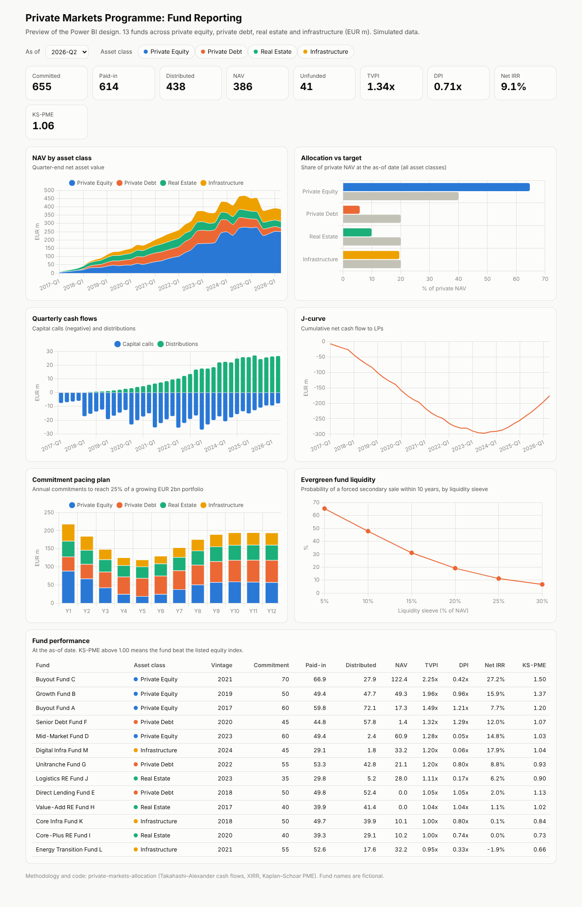

# Private Markets Reporting Dashboard (Power BI)

A fund-reporting dashboard for a multi-asset private markets programme (private equity, private
debt, real estate, infrastructure). It covers the figures an LP reporting or investment team
produces every quarter: **paid-in, distributions, NAV, unfunded commitments, TVPI / DPI / RVPI,
net IRR (XIRR), Kaplan–Schoar PME**, allocation against target, the commitment pacing plan and the
liquidity of an evergreen fund.

**Interactive preview:** `dashboard.html` (open it in a browser, or enable GitHub Pages)



> Data is **simulated** by the companion Python project
> [Private-Market-Allocation](https://github.com/Diptakshi/Private-Market-Allocation) (Takahashi–Alexander cash-flow model).
> Fund names are fictional.

## Open it in Power BI (Windows)
1. Download the repo (Code → Download ZIP) and unzip it.
2. Open `pbip/Private_Markets_Dashboard.pbip` in Power BI Desktop.
3. Click **Refresh**. The data loads straight from this repo; if asked for credentials for
   `raw.githubusercontent.com`, choose **Anonymous**.
4. Check the cards against the expected values in `BUILD_GUIDE.md` (TVPI ≈ 1.34x, DPI ≈ 0.71x, Net IRR ≈ 9%).

The `pbip/` folder is the Power BI Project in text form (TMDL model + report definition), so every
measure, query and visual can be reviewed and versioned in Git.

## Contents
```
pbip/                       Power BI Project: semantic model (tables, relationships, measures) and 4 report pages
*.csv                       star-schema data: dim_fund, dim_date, dim_asset_class, fact_cashflows, fact_benchmark,
                            plus pacing_plan, evergreen_tradeoff and fund_metrics
*.m                         Power Query code: a DataFolder parameter, a reusable fnLoadCsv function,
                            explicit column types and data-quality checks that stop the refresh if a rule breaks
measures.dax                all measures, including XIRR-based Net IRR and KS-PME
BUILD_GUIDE.md              model, pages, formatting and expected values to check against
dashboard.html              HTML preview of the dashboard design (Chart.js)
```

## Data model
```
dim_asset_class (target weights)
        │ 1:*
     dim_fund ──1:*── fact_cashflows ──*:1── dim_date ──1:*── fact_benchmark
```

## Key measures
| Measure | Logic |
|---|---|
| TVPI | (cumulative distributions + NAV at the as-of date) / cumulative paid-in |
| DPI / RVPI | realised / unrealised part of TVPI |
| Net IRR | `XIRR` on net LP flows, with as-of NAV as terminal value |
| KS-PME | flows compounded with the listed index to the as-of date; above 1 = outperformance |
| NAV Weight vs Target | allocation drift by asset class |

*Author: Diptakshi Sen.*
